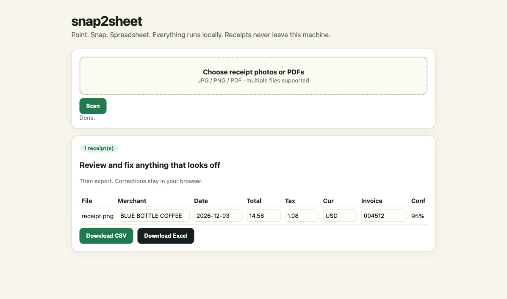

# snap2sheet

Turn receipt photos into a spreadsheet.

Photograph a receipt or invoice. snap2sheet extracts the merchant, date, total, tax, currency, invoice number, and line items. Then it exports a CSV or Excel file. Everything runs locally.



Status: early MVP. The default path uses OCR plus heuristics. An optional LLM pass handles messy receipts. Review the rows before you file them.

## Why

Freelancers, small shops, and families all end up with a pile of receipts. Most expense apps upload every photo and charge a monthly fee. snap2sheet reads the receipt on your machine and gives you a file you own.

It also runs in batch. Point it at a folder and you get one spreadsheet instead of twenty manual entries.

## What it extracts

| Field | Method |
|---|---|
| Merchant | top-of-receipt text, filtered to skip addresses, phone numbers, and receipt labels |
| Date | ISO dates, DD/MM/YYYY, MM/DD/YYYY, and month names. Choose `mdy` or `dmy` order. |
| Total | rows containing TOTAL, but not subtotal or tax. Falls back to the largest amount. |
| Tax | TAX, VAT, GST, and HST rows |
| Currency | ISO codes and the symbols $, EUR, GBP, JPY, and INR |
| Invoice number | Receipt #, Invoice No, Bill #, and Order # |
| Line items | description and amount rows, with quantity parsing |
| Confidence and warnings | missing fields, low OCR confidence, inferred currency |

## Quickstart

```bash
git clone https://github.com/iambiniyam/snap2sheet.git
cd snap2sheet
uv venv && source .venv/bin/activate
uv pip install -e ".[dev]"
snap2sheet scan tests/fixtures/receipt.png
snap2sheet batch ./receipts -o expenses.csv --xlsx expenses.xlsx
snap2sheet serve
```

## CLI

```bash
# one receipt
snap2sheet scan receipt.jpg

# a folder, with day-first dates
snap2sheet batch ./receipts -o expenses.csv --xlsx expenses.xlsx --order dmy

# optional LLM refinement for crumpled or unusual receipts
export SNAP2SHEET_LLM_BASE_URL=https://api.deepseek.com
export SNAP2SHEET_LLM_MODEL=deepseek-chat
export SNAP2SHEET_LLM_API_KEY=...
snap2sheet batch ./receipts -o expenses.csv --llm
```

Example output:

```
snap2sheet, 1 receipt
+-------------+--------------------+------------+-------+------+-----+------+
| File        | Merchant           | Date       | Total | Tax  | Cur | Conf |
+-------------+--------------------+------------+-------+------+-----+------+
| receipt.png | BLUE BOTTLE COFFEE | 2026-12-03 | 14.58 | 1.08 | USD | 0.95 |
+-------------+--------------------+------------+-------+------+-----+------+
```

## Web UI

`snap2sheet serve` opens a multi-file upload page. Every field is editable. Download CSV or Excel when the rows look right. Corrections stay in the browser until you export.

## How it works

```
photo or PDF
  |
  v
render at 200 DPI
  |
  v
RapidOCR
  |
  v
group lines by vertical position
  |
  +--> merchant and date
  +--> total and tax
  +--> line items
  |
  v
CSV or XLSX
```

Row grouping is the important part. Receipt OCR often splits `TOTAL` and `$14.58` into separate boxes. Grouping by vertical position puts them back on the same row.

The default path is fully offline and deterministic. The optional LLM pass can rewrite fields, but it never invents a missing receipt.

## Accuracy and limits

The tests use clean, generated receipts. Real receipts are harder:

- crumpled, faded, thermal paper, or skewed photos
- handwritten totals and tips
- multiple currencies and tax-inclusive totals
- invoices that span several pages (only the first page is read today)
- ambiguous dates such as 03/04/2026, which need `--order mdy` or `dmy`

Low-confidence rows are flagged. Review them before filing.

## Privacy

- No network calls in the default path.
- The web UI writes uploads to `~/.snap2sheet/out`. Delete them at any time.
- The optional LLM pass sends OCR text only, never the image.

## Tests

```bash
pytest -q
```

The suite has 8 tests covering amount parsing, date order, row grouping, extraction, CSV, and Excel.

## Roadmap

- duplicate receipt detection across batches
- multi-page invoices
- tip and discount handling
- category suggestions from line items
- QuickBooks and Xero CSV presets
- a mobile-friendly PWA
- a public benchmark of field-level accuracy on real receipts

## Contributing

See [CONTRIBUTING.md](CONTRIBUTING.md).

## License

MIT. See [THIRD_PARTY.md](THIRD_PARTY.md) for the OCR and PDF dependencies.
